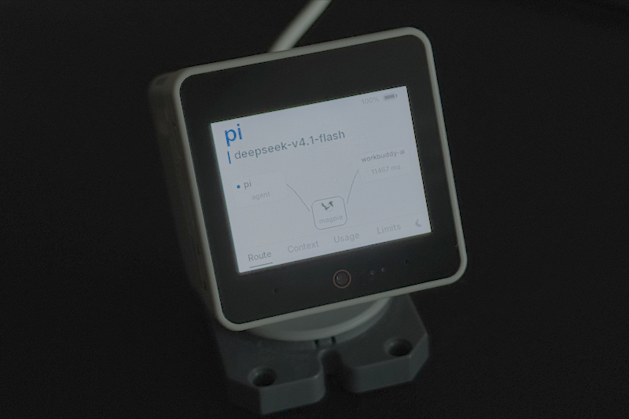

# Magpie Buddy

[English](README.md) · **简体中文**

一块放在桌上的小屏，显示 magpie 在做什么：哪个 agent 发起、哪个模型应答、上下文窗口占了多少、每个订阅还剩多少。请求发出时，一只喜鹊沿链路飞过。



**硬件：** M5Stack CoreS3（ESP32-S3，320×240，8 MB PSRAM，Wi-Fi）。

装在 [StackChan](https://docs.m5stack.com/zh_CN/stackchan) 机身上时，头部的十二颗 RGB 灯跟着同样的状态走：请求在路上时用 agent 自己的色相呼吸，应答落地变薄荷绿，某次尝试失败变红。裸 CoreS3 没有这组灯，固件直接说明这一点，不需要任何配置。

## 跑起来

**1. 桥接** —— 在跑 magpie 的那台机器上：

```sh
node bridge/magpie-display.mjs --discover
```

不用安装、不用编译、没有依赖。它读网关本来就应答的三个 GET，把帧推给板子。

**2. 固件** —— 一次性，走 USB-C：

用 Chrome 或 Edge 打开 **[网页烧录器](https://nullbeing.github.io/magpie-buddy/flasher/)**，点 Connect。不需要装工具链。或者在本地：

```sh
cd firmware
pio run -t upload
```

**3. 网络** —— 用手机，不用重新编译：

板子会升起一个叫 `Magpie-Buddy-XXXX` 的热点，并把名字显示在屏幕上。连上它，配网页会自己弹出（或打开 `http://192.168.4.1`）。选网络、填密码，板子存进 NVS 后重启接入。

按住屏幕三秒可以再次进入配网页。已保存的网络会保留——点一下屏幕就回去。只有串口 `forget` 才会删掉它。

## 四个页面

| 页面 | 显示什么 |
| --- | --- |
| Route | 谁发起、哪个模型应答，以及它们之间的飞行 |
| Context | 上下文窗口，用 magpie 自己的 waffle 按部分着色 |
| Usage | 一周的 token、缓存与调用，即窗口那四张卡与柱状图 |
| Limits | 每个订阅还剩多少，最紧的排在前面 |

左右滑动切换，点标签跳转，点太阳/月亮切主题。深浅两套都在。

## 为什么是桥接而不是插件

magpie 的插件做不了这件事。内置插件要编进主程序，分发它等于把 magpie 拉成分支。JS 插件运行时根本没有网络——没有 `fetch`、没有 socket——够不到板子。桥接站在 magpie 外面，那是唯一同时具备网络和状态的位置。

它不碰 magpie 任何源码：只用网关本来就应答的三个 GET。

## 文档

| | |
| --- | --- |
| [docs/protocol.md](docs/protocol.md) | 线协议：发现、帧、时序，以及一个帧刻意不说什么 |
| [docs/design.md](docs/design.md) | 怎么实现的：预览与渲染器、烘焙的字库、飞行时序、隐私 |
| [bridge/README.md](bridge/README.md) | 桥接的参数，以及它从 trace 里丢弃了什么 |

## 验证

```sh
node bridge/magpie-display.mjs --dry-run --once   # 打印一帧
make -C tools/render                              # 不用板子画出这块屏
cd firmware && pio run                            # 固件能编译
```
